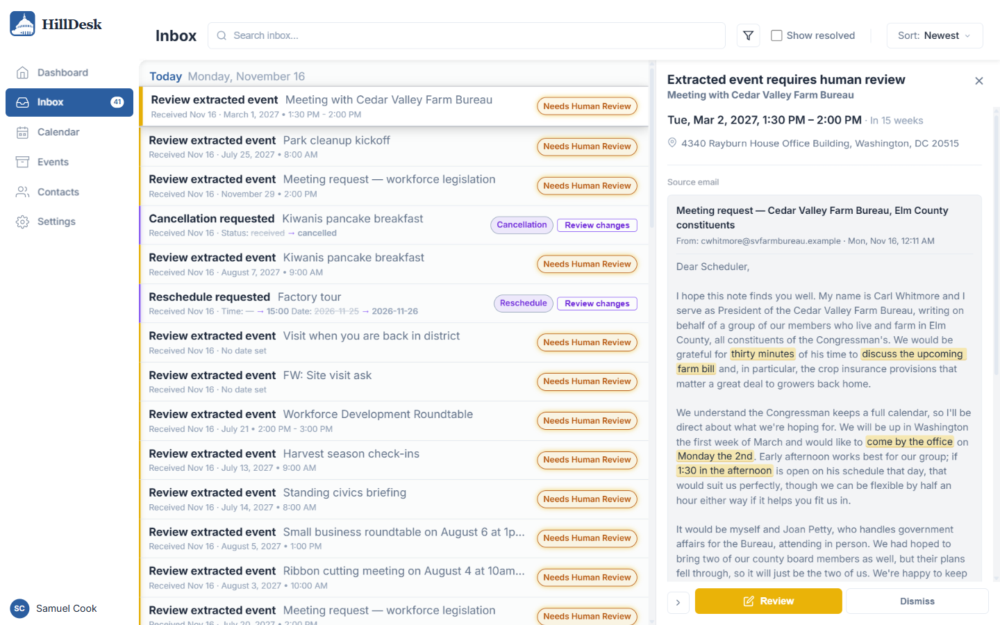
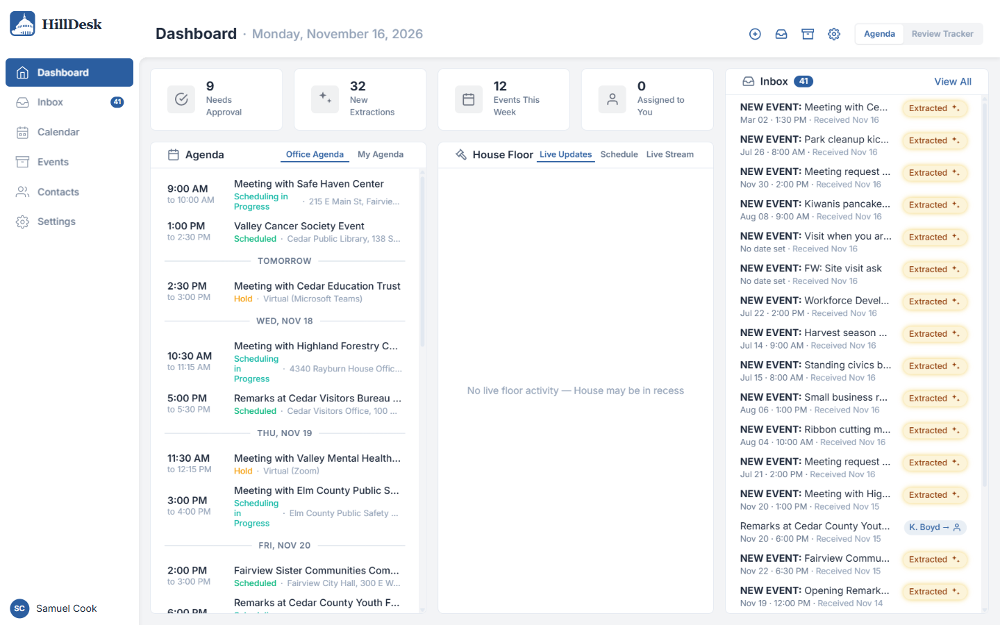
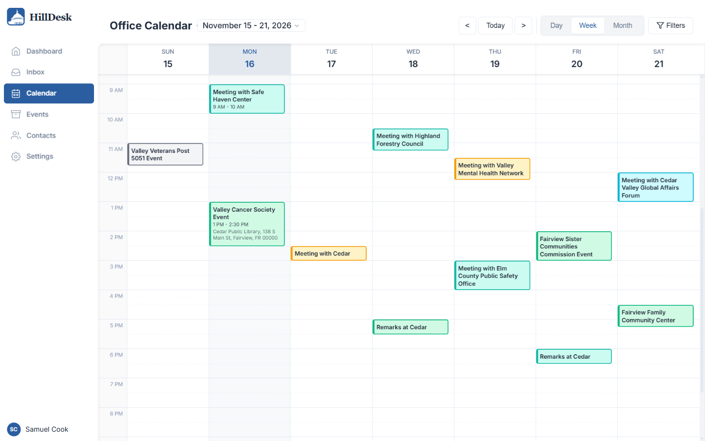

# HillDesk

**Scheduling workflow for U.S. House offices.** HillDesk reads an office's
scheduling inbox, uses AI to pull out the who, what, when and where of each
request, and turns it into a draft event for a staffer to review. Nothing is
scheduled and no email is sent until a person approves it.

HillDesk is free and open source under the [Apache 2.0 license](LICENSE), so
any office, of either party, can use it, adapt it and run it at no cost.

> **Status: beta.** HillDesk is an independent project. It is not produced,
> endorsed or approved by the House or any House or Member office. Running it against House mailboxes requires your own
> security review and approval. See [Deploying](#deploying).



<table>
  <tr>
    <td></td>
    <td></td>
  </tr>
  <tr>
    <td align="center">Dashboard</td>
    <td align="center">Office calendar</td>
  </tr>
</table>

*Screenshots show the fictional demo office (`python manage.py bootstrap_demo`).*

## What it does

- **Outlook ingestion** through Microsoft Graph, from shared scheduling mailboxes
- **A deterministic filtering funnel** that checks headers and authentication,
  sender reputation, duplicates and content before any AI call, and keeps an
  audit log for every message
- **One structured AI extraction per message**: dates, times, location,
  organizations, contacts and topics, with the source text highlighted
- **Human review**: an inbox of draft events, multi-stage approval routing,
  change and cancellation requests matched to existing events, recurring series
- **Calendar, briefings and exports**: calendar views, `.docx` daily and weekly
  briefings, email reply templates, and the House floor schedule
- **Built for locked-down environments**: Amazon Bedrock as the only
  production AI provider, Azure AD sign-in, no public internet required,
  and encrypted PII fields

## Try it in five minutes

The demo runs entirely offline with a mock AI provider and a fictional office
(Rep. James Smith, district FR-1 in the fictional State of Franklin).

**With Docker**

```bash
docker compose up
# then open http://localhost:8000 and sign in as  samuel / demo
```

**Without Docker** (Python 3.10 or newer)

```bash
python -m venv venv
source venv/bin/activate          # Windows: venv\Scripts\activate
pip install -r requirements.txt
python manage.py bootstrap_demo   # migrate + demo office + events + simulated mail
python manage.py runserver
```

Every demo account uses the password `demo`. Demo tools refuse to run unless
`DEBUG=True`.

## How it works

```
Outlook mailbox ─► reception ─► funnel (no AI) ─► one extraction call ─► draft items ─► staff review
```

The AI has no tools and no write access. It returns data that lands in a
review queue, and every outcome needs a human decision. Details:
[docs/architecture.md](docs/architecture.md) and
[docs/security-model.md](docs/security-model.md).

## Deploying

HillDesk is designed for a private AWS environment: containers on ECS
Fargate, PostgreSQL, Redis, Amazon Bedrock and Azure AD. Production settings
refuse to start without real secrets or with any AI provider other than
Bedrock.

- [docs/deployment.md](docs/deployment.md): infrastructure and configuration
- [docs/graph-setup.md](docs/graph-setup.md): Microsoft Graph app registration,
  scoped to one mailbox
- [docs/office-setup.md](docs/office-setup.md): first-day setup for an office

**House offices:** any deployment that reads House mail needs approval from
the House's IT security approvers. Start that conversation before you deploy.

## Support

This is a volunteer project. There is no service-level agreement, and the
maintainer does not provide deployment or setup services. See
[SUPPORT.md](SUPPORT.md). Report vulnerabilities privately as described in
[SECURITY.md](SECURITY.md).

## Contributing

Issues and pull requests are welcome. See [CONTRIBUTING.md](CONTRIBUTING.md)
and the [Code of Conduct](CODE_OF_CONDUCT.md). Never paste real constituent or
office email into an issue.

HillDesk was built with the help of AI coding assistants; `CLAUDE.md` records
the conventions they follow.

## License

[Apache 2.0](LICENSE). "HillDesk" and the HD logo are trademarks. An office
can run HillDesk for its own staff under the HillDesk name, with or without
changes; a modified version distributed or offered to others needs its own
name. See [NOTICE](NOTICE).
