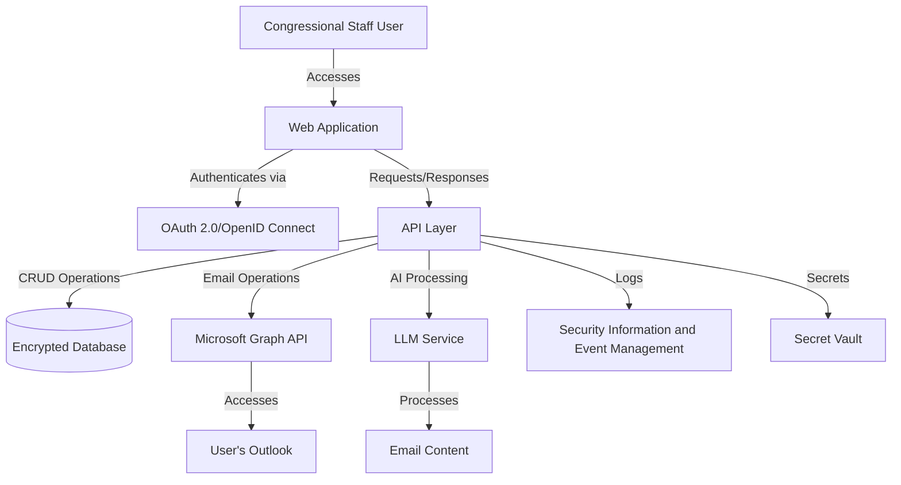
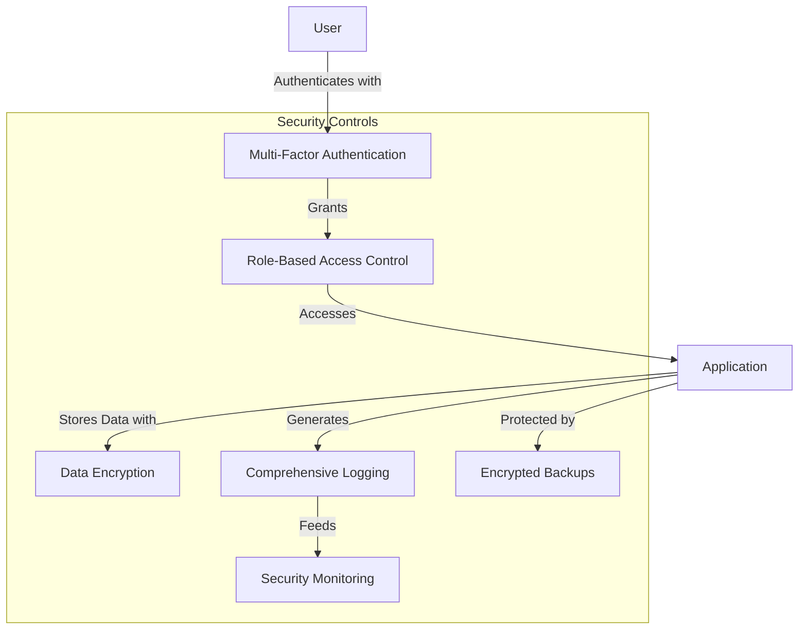

# Design Document: Congressional Staff Scheduling App

## Overview

The Congressional Staff Scheduling App is a secure, integrated application designed to streamline the process of managing meeting requests, events, and speaking engagements for congressional staff. The application integrates with Microsoft Outlook via the Graph API to automatically process incoming emails, leveraging AI to extract relevant scheduling information and providing an intuitive interface for staff to manage their schedule.

This design document outlines the architecture, components, data models, and implementation strategies for the application, with a strong emphasis on security and compliance with congressional IT standards and FedRAMP requirements.

## Architecture

The application follows a modern, secure, cloud-based architecture built primarily with Python and Django, deployed on AWS. The key components are:

### High-Level Architecture



### Security Architecture



### Technology Stack

1. **Backend Framework**: Django 4.x with Django REST Framework
2. **Frontend**: Django Templates with JavaScript/HTMX for dynamic interactions
3. **Database**: PostgreSQL on AWS RDS
4. **Authentication**: Django Authentication with OAuth2 integration
5. **Task Queue**: Celery with Redis for asynchronous processing
6. **AI Integration**: Python-based LLM integration using libraries like Langchain
7. **Testing**: pytest for unit and integration testing

### Deployment Architecture

The application will be deployed on AWS using infrastructure-as-code (Terraform) with the following components:

1. **Web Tier**: Django application deployed on AWS Elastic Beanstalk or ECS with auto-scaling
2. **Database**: AWS RDS PostgreSQL with encryption and Multi-AZ deployment
3. **Cache & Queue**: AWS ElastiCache (Redis) for session management and task queues
4. **AI Processing**: AWS Lambda functions for serverless LLM integration
5. **Storage**: AWS S3 for static files and backups with server-side encryption
6. **CDN**: AWS CloudFront for content delivery
7. **Security Services**: AWS WAF, AWS Secrets Manager, AWS CloudTrail, and AWS CloudWatch
8. **Identity Management**: AWS Cognito for OAuth integration and MFA

## Components and Interfaces

### Frontend Components

1. **Authentication Module**
   - Handles user login, MFA, and session management
   - Integrates with OAuth 2.0/OpenID Connect

2. **Dashboard Component**
   - Provides overview of pending requests and upcoming events
   - Shows notifications and alerts

3. **Inbox Component**
   - Displays non-reviewed entries
   - Shows extracted information alongside original emails
   - Provides verification and response interfaces

4. **Schedule Component**
   - Implements list view with sorting and filtering
   - Implements calendar view with month/week/day options
   - Provides color-coding based on event status

5. **Archive Component**
   - Displays historical events in list view
   - Provides search and filtering capabilities

6. **Settings Component**
   - Manages user preferences (light/dark mode, accent color)
   - Manages email templates
   - Configures notification preferences

### Backend Components

1. **API Gateway**
   - Handles authentication and authorization
   - Routes requests to appropriate services
   - Implements rate limiting and request validation

2. **Email Integration Service**
   - Connects to Microsoft Graph API
   - Retrieves and processes emails
   - Sends responses via Outlook

3. **AI Processing Service**
   - Analyzes emails to identify scheduling requests
   - Extracts relevant information from emails
   - Provides confidence scores for extracted data

4. **Event Management Service**
   - Handles CRUD operations for events
   - Manages event status and metadata
   - Synchronizes with Outlook calendar

5. **Template Management Service**
   - Stores and retrieves email templates
   - Handles template customization
   - Processes template variables

6. **Security Services**
   - Manages encryption/decryption
   - Handles logging and audit trails
   - Monitors for security anomalies

### External Interfaces

1. **Microsoft Graph API**
   - Authentication: OAuth 2.0 client credentials flow
   - Endpoints: Mail, Calendar, Contacts
   - Operations: Read emails, Create calendar events, Send emails

2. **LLM Service API**
   - Authentication: API key stored in secret vault
   - Endpoints: Text analysis, Entity extraction
   - Operations: Classify emails, Extract event details

## Data Models

### User Model

```json
{
  "id": "string (UUID)",
  "email": "string (email address)",
  "name": "string",
  "role": "string (enum: admin, staff)",
  "preferences": {
    "theme": "string (enum: light, dark)",
    "accentColor": "string (enum: blue, red)",
    "defaultView": "string (enum: list, calendar)"
  },
  "lastLogin": "datetime",
  "mfaEnabled": "boolean",
  "created": "datetime",
  "modified": "datetime"
}
```

### Event Model

```json
{
  "id": "string (UUID)",
  "type": "string (enum: event, meeting, speaking)",
  "startDate": "datetime",
  "endDate": "datetime (nullable)",
  "time": "string",
  "location": "string",
  "group": "string",
  "details": "string",
  "legislativeTopics": ["string"],
  "participants": ["string"],
  "pointOfContact": {
    "name": "string",
    "email": "string",
    "phone": "string"
  },
  "scheduleNotes": "string",
  "staffRecommendation": "string (enum: 1-9, Pass)",
  "campaignNotes": "string",
  "hmsNotes": "string",
  "staff": ["string"],
  "status": "string (enum: received, hold, referred, fyied, schedulingInProgress, scheduled, rsvped, regretsSent, passed, canceled, requiresHmsReview)",
  "hmsReviewStatus": "string (enum: yes, complete)",
  "originalEmailId": "string",
  "outlookCalendarEventId": "string (nullable)",
  "created": "datetime",
  "createdBy": "string (user id)",
  "modified": "datetime",
  "modifiedBy": "string (user id)",
  "changeHistory": [
    {
      "timestamp": "datetime",
      "userId": "string",
      "field": "string",
      "oldValue": "any",
      "newValue": "any"
    }
  ],
  "dataClassification": "string (enum: public, internal, sensitive, restricted)"
}
```

### Email Template Model

```json
{
  "id": "string (UUID)",
  "name": "string",
  "subject": "string",
  "body": "string",
  "variables": ["string"],
  "isDefault": "boolean",
  "created": "datetime",
  "createdBy": "string (user id)",
  "modified": "datetime",
  "modifiedBy": "string (user id)"
}
```

### Email Processing Model

```json
{
  "id": "string (UUID)",
  "emailId": "string",
  "subject": "string",
  "sender": "string",
  "received": "datetime",
  "isSchedulingRequest": "boolean",
  "confidence": "number",
  "extractedData": {
    "type": "string",
    "startDate": "datetime",
    "endDate": "datetime",
    "time": "string",
    "location": "string",
    "group": "string",
    "details": "string",
    "legislativeTopics": ["string"],
    "participants": ["string"],
    "pointOfContact": {
      "name": "string",
      "email": "string",
      "phone": "string"
    }
  },
  "processed": "datetime",
  "status": "string (enum: pending, processed, verified, rejected)",
  "eventId": "string (UUID, nullable)"
}
```

## Error Handling

### Error Categories

1. **Authentication Errors**
   - Invalid credentials
   - Expired tokens
   - Insufficient permissions

2. **API Integration Errors**
   - Microsoft Graph API connectivity issues
   - Rate limiting
   - Permission issues

3. **Data Processing Errors**
   - Email extraction failures
   - LLM processing errors
   - Data validation errors

4. **User Input Errors**
   - Invalid form submissions
   - Validation failures
   - Duplicate entries

5. **System Errors**
   - Database connectivity issues
   - Service unavailability
   - Resource constraints

### Error Handling Strategy

1. **Logging**
   - All errors will be logged with:
     - Timestamp
     - Error type and code
     - User ID (if applicable)
     - Request details
     - Stack trace (for system errors)
   - Logs will be forwarded to SIEM in real-time

2. **User Feedback**
   - Friendly error messages for user-facing errors
   - Clear instructions for resolution when possible
   - Error reference codes for support inquiries

3. **Retry Mechanisms**
   - Automatic retries for transient errors with exponential backoff
   - Circuit breakers for failing external services
   - Fallback mechanisms for critical operations

4. **Monitoring and Alerts**
   - Real-time alerts for critical errors
   - Error rate monitoring and thresholds
   - Anomaly detection for unusual error patterns

5. **Recovery Procedures**
   - Documented recovery procedures for each error category
   - Automated recovery where possible
   - Manual intervention protocols for critical failures

## Testing Strategy

### Test Types

1. **Unit Testing**
   - Component-level tests for all services
   - Mock external dependencies
   - Coverage target: 80%+

2. **Integration Testing**
   - Service-to-service integration tests
   - Database integration tests
   - External API integration tests with mocks

3. **Security Testing**
   - Static Application Security Testing (SAST)
   - Dynamic Application Security Testing (DAST)
   - Dependency vulnerability scanning
   - Penetration testing (quarterly)

4. **Performance Testing**
   - Load testing for expected user volumes
   - Stress testing for peak loads
   - Endurance testing for long-running operations
   - API response time benchmarking

5. **User Acceptance Testing**
   - Feature validation against requirements
   - Workflow testing with real-world scenarios
   - Accessibility testing (WCAG 2.1 AA compliance)

### Test Environments

1. **Development Environment**
   - Individual developer environments
   - Unit and integration tests
   - Mocked external services

2. **Testing Environment**
   - Shared testing environment
   - Integration and performance tests
   - Sanitized test data

3. **Staging Environment**
   - Production-like environment
   - Full integration with external services
   - Security and performance testing
   - User acceptance testing

4. **Production Environment**
   - Monitoring and observability
   - Canary deployments
   - A/B testing capabilities

### Continuous Integration/Continuous Deployment

1. **CI Pipeline**
   - Automated builds on code push
   - Unit and integration tests
   - Static code analysis
   - Security scanning
   - Code quality metrics

2. **CD Pipeline**
   - Automated deployments to test environments
   - Manual approval gates for production
   - Rollback capabilities
   - Configuration validation

## Security Implementation

### Authentication and Authorization

1. **User Authentication**
   - OAuth 2.0/OpenID Connect implementation
   - Multi-factor authentication for all users
   - Session management with secure cookies
   - Account lockout after failed attempts

2. **Authorization**
   - Role-based access control (RBAC)
   - Attribute-based access control for sensitive operations
   - Least privilege principle enforcement
   - Regular permission audits

### Data Protection

1. **Data at Rest**
   - AES-256 encryption for all stored data
   - Customer-managed encryption keys
   - Secure key management with rotation
   - Database-level encryption

2. **Data in Transit**
   - TLS 1.2+ for all communications
   - Certificate validation and pinning
   - Mutual TLS for service-to-service communication
   - HTTP security headers (HSTS, CSP, etc.)

3. **Data Classification**
   - Automated classification based on content
   - Manual classification override
   - Handling procedures for each classification level
   - Data loss prevention measures

### Secure Development

1. **Secure Coding Practices**
   - OWASP Top 10 and CWE Top 25 mitigations
   - Secure coding standards and guidelines
   - Regular security training for developers
   - Code review with security focus

2. **Dependency Management**
   - Automated vulnerability scanning
   - Dependency update policies
   - Software Bill of Materials (SBOM)
   - Approved component list

### Compliance and Auditing

1. **Audit Logging**
   - Comprehensive logging of all user actions
   - Immutable audit trails
   - Log integrity verification
   - Long-term log retention (3+ years)

2. **Compliance Monitoring**
   - Continuous compliance checking
   - Regular security assessments
   - Automated policy enforcement
   - Compliance reporting

## Deployment and Operations

### Deployment Strategy

1. **Infrastructure as Code**
   - Terraform for infrastructure provisioning
   - Version-controlled infrastructure definitions
   - Policy as code for security guardrails
   - Immutable infrastructure approach

2. **Containerization**
   - Docker containers for application components
   - Container security scanning
   - Minimal base images
   - No privileged containers

3. **CI/CD Pipeline**
   - Automated builds and deployments
   - Environment promotion workflow
   - Deployment approval gates
   - Automated rollback capabilities

### Monitoring and Observability

1. **Application Monitoring**
   - Performance metrics collection
   - Error rate tracking
   - User experience monitoring
   - Business KPI tracking

2. **Security Monitoring**
   - Real-time threat detection
   - Anomaly detection
   - Security event correlation
   - Automated response playbooks

3. **Infrastructure Monitoring**
   - Resource utilization tracking
   - Availability monitoring
   - Cost optimization
   - Capacity planning

### Backup and Recovery

1. **Backup Strategy**
   - Daily encrypted backups
   - Multi-region backup storage
   - Backup integrity verification
   - Retention policy enforcement

2. **Disaster Recovery**
   - Documented recovery procedures
   - Regular recovery testing
   - Recovery time objectives (RTO)
   - Recovery point objectives (RPO)

## User Interface Design

### Design Principles

1. **Simplicity**
   - Clean, uncluttered interfaces
   - Focused on core functionality
   - Progressive disclosure of complex features
   - Consistent visual language

2. **Efficiency**
   - Minimal clicks for common tasks
   - Keyboard shortcuts for power users
   - Batch operations where appropriate
   - Responsive performance

3. **Accessibility**
   - WCAG 2.1 AA compliance
   - Screen reader compatibility
   - Keyboard navigation
   - Color contrast requirements

### Visual Design

1. **Color Scheme**
   - Light mode: White background, dark text, accent color
   - Dark mode: Dark background, light text, accent color
   - Accent color options: Democrat blue or Republican red
   - High contrast mode for accessibility

2. **Typography**
   - Sans-serif system fonts for readability
   - Clear hierarchy with size and weight
   - Consistent line spacing
   - Minimum text size for readability

3. **Layout**
   - Responsive design for all screen sizes
   - Consistent grid system
   - Whitespace for visual separation
   - Logical grouping of related elements

### Key Screens

1. **Dashboard**
   - Summary statistics
   - Recent activity
   - Upcoming events
   - Quick action buttons

2. **Inbox**
   - Email list with extraction status
   - Preview pane for email content
   - Extraction verification interface
   - Response options

3. **Schedule (List View)**
   - Sortable columns
   - Filter controls
   - Bulk action options
   - Inline editing capabilities

4. **Schedule (Calendar View)**
   - Month/week/day toggle
   - Color-coded events
   - Drag-and-drop rescheduling
   - Quick event creation

5. **Event Detail Pop-up**
   - Complete event information
   - Original email display
   - Edit controls
   - Response management

6. **Settings**
   - Theme selection
   - Accent color selection
   - Template management
   - Notification preferences